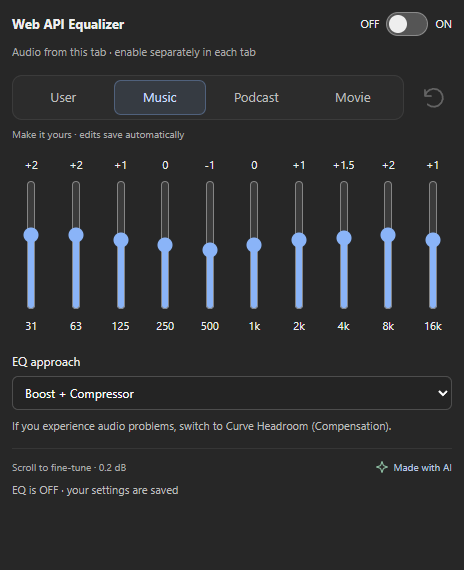

# Web API Equalizer

A standalone Manifest V3 extension for Chrome, Edge and Brave (Chromium 116+).
Click the extension icon to open the equalizer, then turn ON to process the
current tab's audio. Processing continues when the popup closes and across
navigation while the browser keeps the captured tab stream alive.



## Install

The ready-to-load extension is in `dist/`.

1. Open `chrome://extensions` (or `edge://extensions` / `brave://extensions`).
2. Enable **Developer mode**.
3. Choose **Load unpacked** and select this project's `dist` folder.
4. Pin **Web API Equalizer**, open a website playing audio, click the icon and
   turn the EQ switch ON. The extension badge shows ON for active tabs.

Turn OFF to release the tab stream and restore normal browser audio routing.
Enable each tab explicitly. Merely opening the popup does not capture audio.
Tabs can be processed simultaneously. Band settings, preset edits and the
approach are shared between enabled tabs and survive browser restarts. Capture
itself does not automatically restart after a browser restart or a stream ends;
open the popup and enable that tab again.

## Controls

- Ten peaking filters: 31.25 Hz through 16 kHz, Q 1.4, -12 to +12 dB.
- User, Music, Podcast and Movie presets with independently saved edits.
- Restore defaults for the selected preset; other presets retain their edits.
- Sliders: 0.1 dB steps; mouse wheel: 0.2 dB. Ctrl/Meta wheel keeps browser zoom.
- Boost + Compressor, Direct Boost and Curve Headroom (Compensation).
- Gain changes use 20 ms smoothing. Headroom estimates the combined filter curve.

Compressor mode changes dynamics and adds latency. Direct boosts can clip.
Curve Headroom reduces overall level to compensate for the filter curve; none
of these approaches guarantees true-peak limiting.

## Website support and privacy

The extension processes the whole tab's audio through `tabCapture` and Web Audio
in an offscreen document. It is independent of website markup, video elements,
iframes and website media CORS rules. No YouTube-specific code or injected
toolbar is used. All processing is local; there is no recording, upload,
microphone permission or external service.

Regular HTTP/HTTPS sites are supported when Chromium allows tab audio capture.
Browser internal pages, the web store and protected/DRM media may block capture.
Local files additionally require the browser's **Allow access to file URLs**
setting. Remote casting and audio outside the browser tab are not processed.
Capture support is controlled by the browser, so support for every page cannot
be guaranteed. Firefox and Safari are not supported by this build.

Permissions: `tabCapture` for selected-tab audio, `offscreen` for persistent audio
processing, `storage` for settings, and `activeTab` for the tab explicitly opened
through the extension. There are no broad website host permissions.

## Development

Requires Node.js 24+:

```sh
npm ci
npm run check
```

`npm run build` rebuilds `dist/`. Reload the unpacked extension after rebuilding.
`npm test` runs profile, response, audio-graph, background and UI regression tests.

The popup renders the extracted equalizer controls directly. The service worker
serializes commands and owns settings and capture permissions. The offscreen
document owns one Web Audio graph per captured tab. It reconnects captured audio
to the speakers, cleans up failed starts and ended streams, and releases tracks
and contexts when switched OFF or a tab closes. The audio document uses the
`USER_MEDIA` reason so paused audio does not trigger the 30-second idle timeout
associated with `AUDIO_PLAYBACK`.

The portable profile, approach modules, response estimator, control layout and
EQ styles were extracted from Open YouTube Tools. The original project is
unchanged. This folder is an independent Git repository with no configured remote.

Chrome API references:
[tabCapture](https://developer.chrome.com/docs/extensions/reference/api/tabCapture),
[offscreen](https://developer.chrome.com/docs/extensions/reference/api/offscreen),
[background tab capture](https://developer.chrome.com/docs/extensions/how-to/web-platform/screen-capture).

## Browser acceptance

Automated tests use simulated browser APIs and do not certify audible output.
Before publishing, verify with actual audio in the target browser:

1. Play audio on YouTube and a second non-YouTube site. Enable EQ and listen for
   clear bass/midrange cuts and boosts; compare all approaches at modest volume.
2. Close the popup and confirm EQ persists. Reopen it and check the active switch.
3. Edit each preset, switch presets, restore one, and restart the browser to
   confirm independent saved curves and explicit per-tab reactivation.
4. Enable two tabs, edit shared settings, and turn one tab OFF; confirm the other
   continues processing and the first returns to normal playback.
5. Repeat ON/OFF, pause, seek, navigate, close a captured tab, and reload the
   extension. Confirm no doubled audio or lasting silence. Check stream-ended
   status and re-enable when necessary.
6. Try an internal/protected page and confirm a readable activation error.
